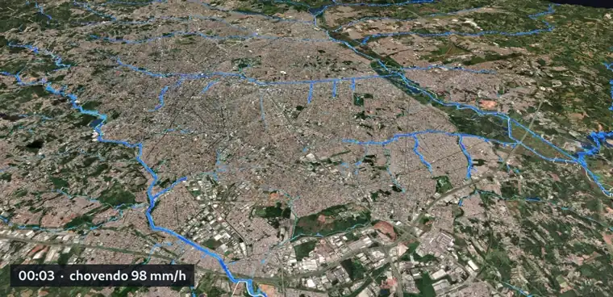
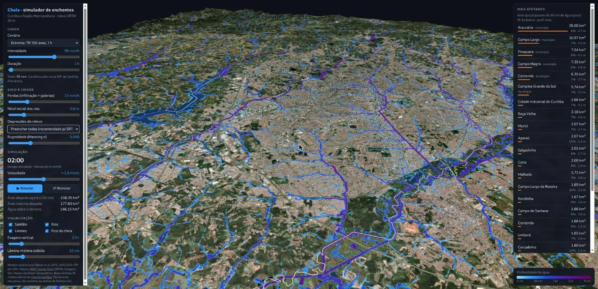
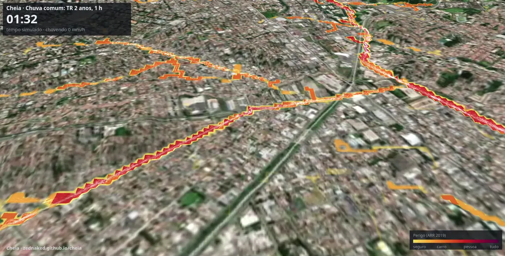
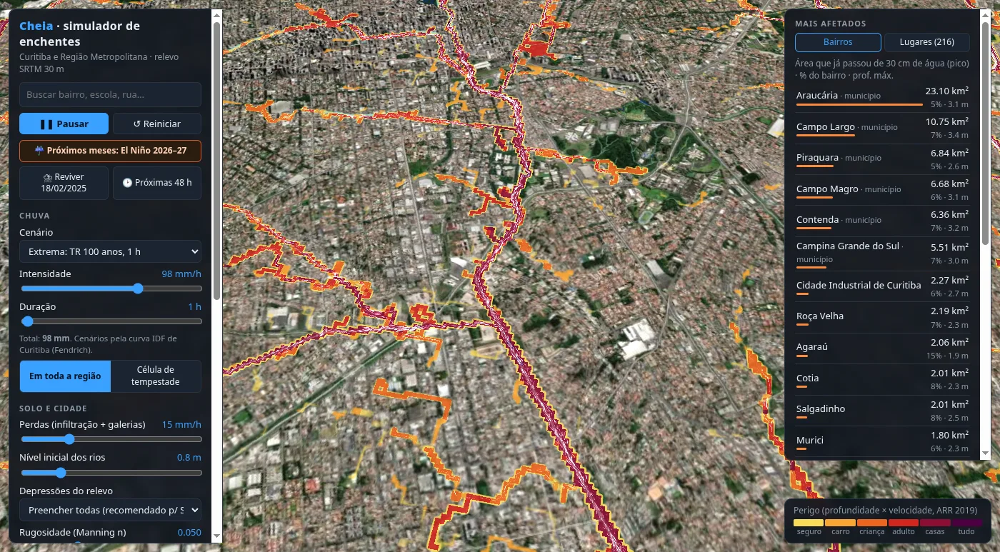
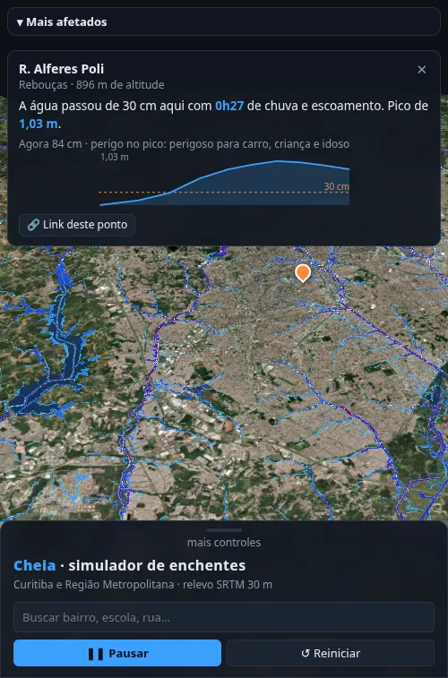
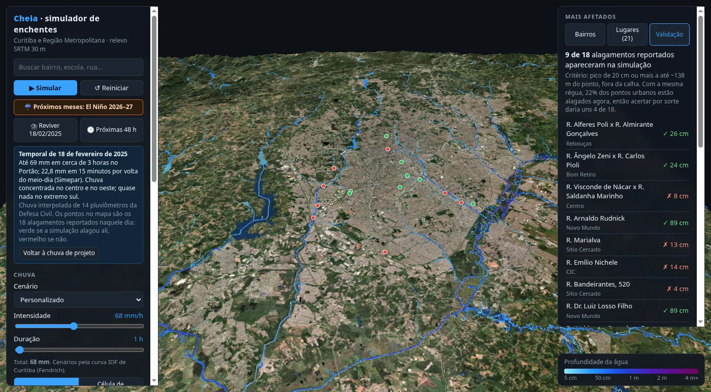
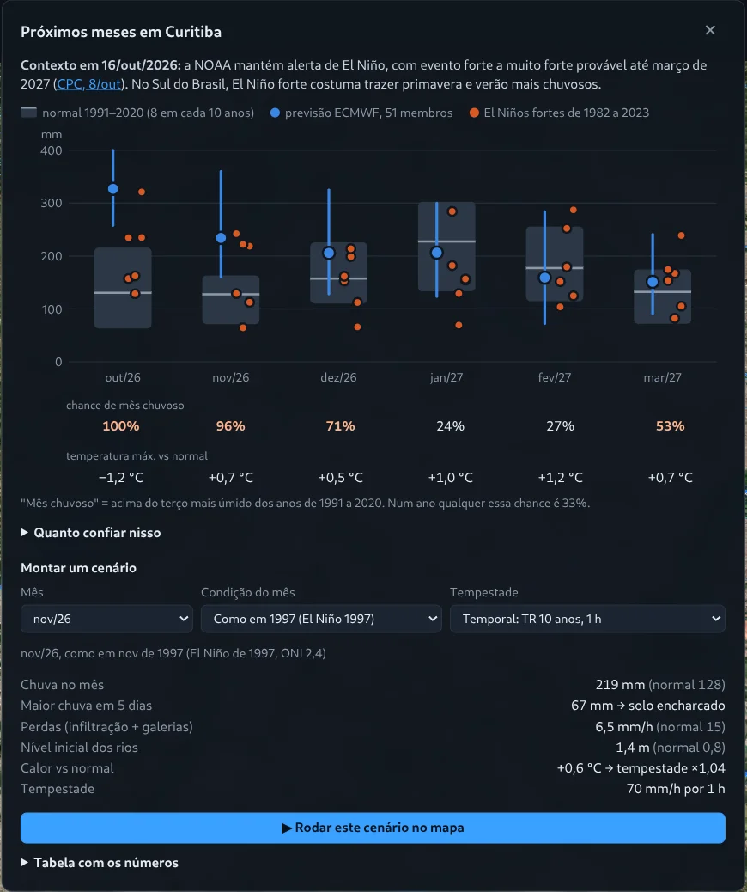
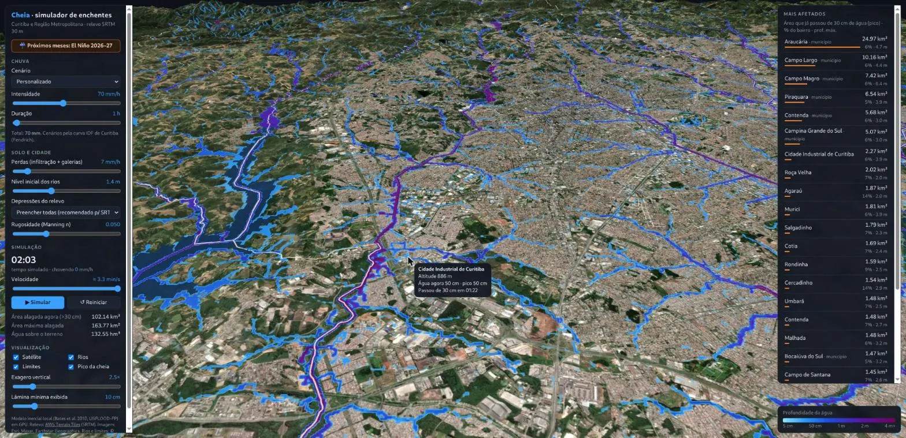
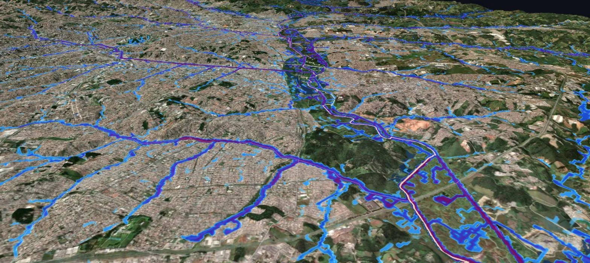

# Cheia

**A flood simulator for Curitiba and its metropolitan area that runs in a
browser tab.** Pick a rainstorm, in mm/h or from Curitiba's own
intensity-duration-frequency curve, and watch the water run down the real
terrain, fill the rivers and spill into the neighbourhoods. A live ranking lists
the neighbourhoods and towns with the most land under water, and how many
schools, hospitals and kilometres of street the water reached. Search for your
street and it tells you at what time the water passes 30 cm there. Drop a storm
cell on a neighbourhood, replay the storm of 18 February 2025 from the rain
gauges, or run the next 48 hours of forecast. With a strong El Niño forming, a
panel puts the next six months of forecast rain and heat next to what past El
Niños did.

**[Open it](https://zednaked.github.io/cheia/)** · Nothing to install ·
Interface in Portuguese · [Leia em português](README.pt-BR.md)

```
2.4 million cells of water, one shader pass per step, 5.9 ms a step
81 fps on an integrated laptop GPU, 4 simulated minutes per second
storm of 18 Feb 2025: the model flooded 9 of the 18 reported spots
                      (by chance, with the same yardstick, about 4)
2-year storm (the every-summer one): 1.78 m at Wenceslau Braz x Linha Verde
```

**On this page:** [what the simulation found](#what-the-simulation-found) ·
[what you can do](#what-you-can-do) ·
[checked against a real storm](#checked-against-a-real-storm) ·
[the next six months](#the-next-six-months) · [methods](#methods) ·
[what it can't see](#what-it-cant-see)



*A 100-year storm (98 mm in one hour), two simulated hours, recorded from the
browser. Light blue is a few centimetres, purple is two metres and more.*

I went looking for what already existed for Curitiba before writing any of
this. Google's Flood Hub forecasts slow river floods and says plainly that it
does not cover flash floods in large cities, which is what Curitiba gets. The
state's drainage master plan has flood lines per river, as PDFs from 2002.
Researchers have mapped flood risk for single basins. Nothing let you ask
*"what if it rains 80 mm in an hour, where does the water go?"* and see the
answer on the map.



## What the simulation found

I ran Curitiba's design storms (2-, 10- and 100-year one-hour storms, and a
25-year three-hour one) over the whole region and measured three things: the
water at the 18 spots that actually flooded on 18 Feb 2025, the share of each
neighbourhood that passed 30 cm, and which schools, day-care centres, health
units and streets got dangerous water. How it was done is under
[Methods](#methods); the full numbers are in [`docs/analise.json`](docs/analise.json).

**1. Parolin, Fanny and Novo Mundo flood even in the every-summer storm.** A
2-year storm (52 mm in one hour) already puts 1.78 m of water at the Wenceslau
Braz x Linha Verde junction, 1.39 m on the Henry Ford stream and 1.27 m on Rua
Dr. Luiz Losso Filho, where water passes 30 cm within 5 minutes. At all three
the current is already unsafe for anyone. They are valley bottoms that collect
the water of several neighbourhoods.



**2. The worst comes after the rain stops.** In the bigger valleys the peak
arrives 30 minutes to almost 2 hours after the rain starts, when the whole
basin's water reaches the river. In Boqueirão (Carlos Essenfelder x Cleto da
Silva) water passes 30 cm only 1h53 in, in a 100-year storm.

**3. Intensity matters more than volume.** The 25-year three-hour storm (more
water in total) put less water on almost every spot than the 10-year one-hour
storm. In Curitiba the danger is the short, heavy downpour.

**4. Six of the 18 reported spots stay dry in any storm.** Sítio Cercado (2),
CIC (2), Fazendinha and Campo Comprido never pass 5 cm even in the 100-year
storm, and the centre (Visconde de Nácar) never passes 12 cm. Those floods are
drainage failures: blocked drains, undersized galleries, flat streets with
nowhere to go. 30 m terrain can't see that, and the model must not be used to
call those places safe.

**5. The neighbourhoods with the largest share under water are outside
Curitiba.** In the 10-year storm, Alto Tarumã (15%), Parque das Águas (14%) and
Jardim Claudia (11%) in Pinhais, Agaraú (14%) in São José dos Pinhais and
Guaraituba (13%) in Colombo sit on the floodplains of the Iraí, Palmital, Atuba
and upper Iguaçu. Inside Curitiba the top ones are Alto da Rua XV, Augusta,
Hugo Lange and Santo Inácio (8 to 10%), partly the Belém and Barigui
floodplains and parks, which are meant to fill.

### The 18 spots of 18 Feb 2025, in four storms

Peak depth in a 3 × 3 cell box (about 100 m) around the spot; in brackets, how
long after the rain started it passed 30 cm; H is the hazard class at the peak.

```
                                         2-yr, 1 h         10-yr, 1 h        25-yr, 3 h        100-yr, 1 h
Parolin     Wenceslau Braz x Linha Verde 1.78 m (36′) H5   2.32 m (31′) H5   2.12 m (63′) H5   3.14 m (21′) H6
Fanny       Henry Ford stream            1.39 m (31′) H4   1.82 m (26′) H5   1.32 m (47′) H4   2.44 m (21′) H5
Novo Mundo  Dr. Luiz Losso Filho         1.27 m  (5′) H4   1.68 m  (5′) H4   1.36 m (16′) H4   2.31 m  (5′) H5
Parolin     Prof. Porthos Velozo         58 cm  (72′) H3   78 cm  (57′) H4   61 cm (105′) H3   1.06 m (42′) H5
Rebouças    Alferes Poli x A. Gonçalves  52 cm  (51′) H3   69 cm  (42′) H3   62 cm  (74′) H3   1.03 m (32′) H3
Novo Mundo  Arnaldo Rudnick              31 cm  (93′) H2   68 cm  (62′) H3   38 cm (135′) H2   1.30 m (47′) H4
Bom Retiro  Ângelo Zeni x Carlos Pioli   31 cm  (51′) H2   41 cm  (42′) H4   24 cm        H1   65 cm  (32′) H5
Uberaba     José Hauer x Salgado Filho   25 cm        H1   33 cm  (57′) H2   26 cm        H1   46 cm  (37′) H2
Boqueirão   Carlos Essenfelder x Cleto   11 cm        H1   13 cm        H1    8 cm        H1   1.16 m (113′) H3
Parolin     Brigadeiro Franco             2 cm        H0    3 cm        H0    2 cm        H0   33 cm  (68′) H2
Centro      Visconde de Nácar x Saldanha  8 cm        H1   10 cm        H1    6 cm        H1   12 cm        H1
Boqueirão   Aristóteles da Silva Santos   2 cm        H0    2 cm        H0    2 cm        H0    3 cm        H0
CIC         Mané Garrincha park           3 cm        H0    4 cm        H0    3 cm        H0    5 cm        H1
CIC, Sítio Cercado (2), Fazendinha,
Campo Comprido                           up to 3 cm in every storm

H1 shallow · H2 sweeps a small car · H3 unsafe for children and the elderly · H4 unsafe for anyone
H5 light buildings at risk · H6 any building may fail
```

### Where the water reaches those who need help most

To rank neighbourhoods by social relevance I counted, in the 10-year storm, the
essential services with more than 30 cm of water at the door, weighted by how
much people depend on them in an emergency (hospital and care home 5, health
unit and day-care 3, school and fire station 2, police 1), and added the
kilometres of street where water starts sweeping cars (H2 or worse). It is a
simple, explicit yardstick, not an official index; income and population
density, for one, are not in the simulator yet.

```
    neighbourhood                 what gets more than 30 cm at the door                  H2+ streets
 1  CIC                           UPA CIC emergency unit, Taiz Viviane Machado health    21 km
                                  unit, 2 schools
 2  Boqueirão                     4 health units (Irmã Tereza Araújo, CAPS, Tapajós,      7 km
                                  UPA Boqueirão), 4 schools, military police
 3  Cajuru                        Senador Enéas Faria school (1.57 m)                    15 km
 4  Eucaliptos (Faz. Rio Grande)  Hortência health unit and 2 schools (about 1 m)        9 km
 5  Xaxim                         Jardim Europa school (1.25 m), 2 health units          5 km
 6  Guaraituba (Colombo)          Angelo Falavinha Dalprá school (1.03 m), a day-care    7 km
 7  Centro                        Colégio Estadual do Paraná (1.25 m), 3 schools          1 km
 8  Palmital (Colombo)            Generosa Simões day-care (1.45 m), 2 schools           5 km
 9  Sítio Cercado                 Parigot de Souza school and day-care (1.30 m)          5 km
10  Uberaba                       Conselheiro Carrão and Michel Khury schools            8 km
```

Each school and clinic position comes from OpenStreetMap and the terrain has
34 m cells: read "water reaches that school's block", not "water enters the
classroom".

### Videos

Recorded in the simulator itself, coloured by hazard. In order of social
priority, 10-year storm:
[1 CIC](https://github.com/zednaked/cheia/raw/main/docs/videos/prioridade/01-cic.mp4) ·
[2 Boqueirão](https://github.com/zednaked/cheia/raw/main/docs/videos/prioridade/02-boqueirao.mp4) ·
[3 Cajuru](https://github.com/zednaked/cheia/raw/main/docs/videos/prioridade/03-cajuru.mp4) ·
[4 Eucaliptos, Fazenda Rio Grande](https://github.com/zednaked/cheia/raw/main/docs/videos/prioridade/04-eucaliptos-fazenda-rio-grande.mp4) ·
[5 Xaxim](https://github.com/zednaked/cheia/raw/main/docs/videos/prioridade/05-xaxim.mp4) ·
[6 Guaraituba, Colombo](https://github.com/zednaked/cheia/raw/main/docs/videos/prioridade/06-guaraituba-colombo.mp4) ·
[7 Centro](https://github.com/zednaked/cheia/raw/main/docs/videos/prioridade/07-centro.mp4) ·
[8 Palmital, Colombo](https://github.com/zednaked/cheia/raw/main/docs/videos/prioridade/08-palmital-colombo.mp4)

Critical spots:
[Parolin and Fanny in a 2-year storm](https://github.com/zednaked/cheia/raw/main/docs/videos/parolin-fanny-chuva-comum.mp4) ·
[Novo Mundo, 10-year](https://github.com/zednaked/cheia/raw/main/docs/videos/novo-mundo-temporal.mp4) ·
[Rebouças, 10-year](https://github.com/zednaked/cheia/raw/main/docs/videos/reboucas-temporal.mp4) ·
[Pinhais, 10-year](https://github.com/zednaked/cheia/raw/main/docs/videos/pinhais-temporal.mp4) ·
[Boqueirão, 100-year](https://github.com/zednaked/cheia/raw/main/docs/videos/boqueirao-extrema.mp4)

The city and the events:
[100-year storm over Parolin](https://github.com/zednaked/cheia/raw/main/docs/videos/extrema-perigo-parolin.mp4) ·
[the storm of 18 Feb 2025 over Portão](https://github.com/zednaked/cheia/raw/main/docs/videos/evento-18-fev-2025.mp4) ·
[10-year storm, the whole city](https://github.com/zednaked/cheia/raw/main/docs/videos/temporal-10-anos.mp4) ·
[storm cell over downtown](https://github.com/zednaked/cheia/raw/main/docs/videos/celula-tempestade-centro.mp4)

## What you can do

- **Find your street.** Search finds neighbourhoods, schools and hospitals
  offline, and addresses through OpenStreetMap. The pin shows when the water
  passed 30 cm there, the peak, the hazard and a chart of the depth over time.
  On a phone, tap the map.
- **Send the link.** The page address holds the rain, the camera and the pin:
  whoever opens it sees the same thing, already running. You can also save an
  image or record a video of the map, with clock and legend.
- **Pick the rain.** Free intensity and duration, or Curitiba's design storms,
  from the every-summer storm (2-year) to the three-day Iguaçu flood (100-year).
  Over the whole region, or as a **storm cell** a few kilometres wide that you
  drop with a click and the wind carries, which is how summer rain falls in
  Curitiba.
- **Replay 18 Feb 2025.** The rain measured at 14 Civil Defence gauges,
  interpolated over the city, with the 18 floods reported that day pinned on
  the map: green if the model flooded the spot, red if not.
- **Run the next 48 hours.** Hourly forecast rain from Open-Meteo at 16 points
  over the region.
- **See hazard, not just depth.** The water can be coloured by the hazard class
  of the Australian ARR 2019 guideline, which combines depth and velocity:
  where water sweeps away a small car, a child, an adult. White streaks show
  the current.
- **Count what matters.** How many schools and day-care centres, hospitals and
  clinics, fire and police stations the water reached, how many kilometres of
  street passed 30 cm and how many became unsafe for cars. A 10-year,
  one-hour storm, two hours in: 503 km of street above 30 cm (66 km of them
  main roads), 519 km unsafe for cars, 90 schools and day-care centres and
  48 health sites with water at the door.





## Checked against a real storm

On Tuesday 18 February 2025 a heavy storm hit Curitiba between late morning and
3 pm: 22.8 mm in 15 minutes around noon (Simepar), 69 mm at Portão, almost
nothing in the far south. The Civil Defence listed the day's flooding spots.
It is the best case I found: an official street-level list, 14 rain gauges the
same day, and a short intense storm, which is what this model exists to show.

**Replay 18/02/2025** does this:

- **Rain in space.** The day totals at the 14 Civil Defence gauges, inverse
  distance squared onto a 32 × 32 grid. Each gauge sits at the centre of the
  neighbourhood it is named after.
- **Rain in time.** 15-minute blocks from 11:30, peaking at noon: 34.6 mm by
  12:15 and 22.8 mm in the heaviest 15 minutes, per Simepar.
- **The spots.** The 15 on the Civil Defence list (as reprinted by Bem Paraná)
  and 3 from Banda B, geocoded with OpenStreetMap.

**The yardstick:** a spot counts as flooded if the model passed 20 cm
somewhere in a 9 × 9 cell box around it (about 310 m across), outside the river
channel. It is loose on purpose: the spot
positions and 30 m terrain don't support anything tighter. So the panel also
says what chance alone would score: with the same yardstick, 22% of urban
points flooded, about 4 of 18.

**The result: 9 of 18.** Hits are where water gathers in urban stream valleys
(Parolin, Novo Mundo, Fanny, Rebouças, Uberaba). Misses are where a river
overflowed with water from far upstream: in the centre the Bigorrilho stream
rose 2.29 m, in Boqueirão the Belém left its channel. How a river fills depends
on rain upstream and on how the real channel drains, and a channel burned from
OSM into 30 m terrain doesn't know that. It also misses in the south, at Sítio
Cercado, where the nearby gauges read 5 to 37 mm and the interpolation pulled
the rain down.



One storm, a loose yardstick and points from the news. Much better than
chance, and far from a real validation, which needs an official flood-prone
area layer to compare outline with outline.

## The next six months

On 8 October 2026 NOAA's Climate Prediction Center kept its El Niño Advisory:
a strong to very strong event is likely through March 2027, with an 83% chance
that October to December is the strongest since 1950. In southern Brazil a
strong El Niño usually means a wet spring and summer, and people in Curitiba
are asking what that does to their street. So the simulator has a second
question now: *not "what if it rains 80 mm" but "what will the month around
that storm look like".*



Three sources, kept apart on purpose:

- **The forecast:** ECMWF SEAS5, 51 members, six months ahead, daily rain and
  temperature for Curitiba, fetched live from Open-Meteo every time the panel
  opens.
- **Normal:** ERA5 reanalysis for the same point, 1991 to 2020.
- **What strong El Niños actually did:** the October to April months of the
  six since 1982 (1982, 1991, 1997, 2009, 2015, 2023), from ERA5. That is
  measurement, not a model, and it is there to check the forecast against.

What it shows today, 16 October 2026:

```
             normal   forecast median (10-90%)   wet month*   max temp
Oct 2026     130 mm   327 mm  (258-400)            100%         -1.2 °C
Nov 2026     128 mm   234 mm  (160-360)             96%         +0.7 °C
Dec 2026     157 mm   206 mm  (128-325)             71%         +0.5 °C
Jan 2027     227 mm   206 mm  (124-300)             24%         +1.0 °C
Feb 2027     177 mm   159 mm   (72-284)             27%         +1.2 °C
Mar 2027     132 mm   151 mm   (91-241)             53%         +0.7 °C

* share of the 51 members above the wettest third of 1991-2020; 33% in any year
```

**Read the forecast as too wet.** It is not bias-corrected: the API has no
hindcasts to correct it with. Over the 26 days to 10 October, where both exist,
the model gave Curitiba **208 mm** and ERA5 recorded **147 mm**, 42% more. That
is too short a window to build a correction on, so the panel prints it instead.
The past El Niños point the same way with no model involved: October in
Curitiba was above its 1991-2020 median (130 mm) in 5 of the 6, at 157 to
321 mm; the sixth, 1991, had 129 mm.

**From a month to a flood.** A seasonal forecast can't say which day the
storm comes. What it can say is what the ground and the rivers will be like
when it does. Pick a month and a condition (the forecast's median, its wet
tenth, or "like 1997") and the panel sets the simulation:

- **Soil.** The wettest 5 days of that month give the SCS curve-number
  antecedent moisture class (dry under 35.6 mm, wet over 53.3 mm), and the
  infiltration-plus-drains loss scales with the retention of that class: 15
  mm/h normal, 6.5 mm/h saturated.
- **Rivers.** The starting water level scales with the month's rain over its
  normal, from 0.3 to 3 m. This one is a heuristic and the panel says so.
- **Heat.** Short storms get about 7% more intense per degree of warming
  (Clausius-Clapeyron). The design storm from Curitiba's IDF curve is scaled by
  the forecast temperature anomaly.

The same storm (10-year, one hour), read after two simulated hours, area that
passed 30 cm of water:

```
                                          18 Oct 2026     16 Oct 2026
normal month                              127 km²         138 km²
soil and rivers like November 1997        140 km²  +10%   165 km²  +19%
the forecast's wet tenth for October      127 km²   0%    177 km²  +29%
```

The 16 October column is the one I first published, and it was inflated: the
fuller river already spilled into the floodplain at the start, and that counted
as flooding (see "The rivers started out overflowing", below). With the fix, a
November-1997 soil and river still add 10% of flooded area. October's wet tenth
comes out the same as normal: October is forecast 1.2 °C cooler than normal,
which makes the storm 8% weaker and cancels the soaked soil. In the first
version, what made the difference there was the 2.1 m river spilling at the
start.



## Methods

### Data

```
grid           1536 × 1536 cells, 34.5 m each, 53 × 53 km
terrain        SRTM 30 m (AWS Terrain Tiles), rivers
               burned and pits treated at build time,   2.8 MB gzip
imagery        Esri World Imagery, 576 tiles,            9.8 MB
rivers, lakes,
boundaries     OpenStreetMap, pre-fetched,               1.5 MB gzip
               3,041 waterways, 1,302 lakes,
               17 municipalities, 289 neighbourhoods,
               1,716 schools, health and emergency sites
streets        OSM road network, 51,129 ways, 13,640 km,
               summarised per cell inside the terrain file
climate        ERA5 1981-2026 summaries, pre-fetched,     32 KB gzip
               SEAS5 seasonal forecast, live,              ~180 KB
model          local inertial shallow water, one fragment shader per step
```

Everything is client-side: no server, no account, no API key. GitHub Pages
serves the HTML, the prepared terrain and the OSM file; the imagery comes
straight from its public tile server and is kept by a service worker, so a
second visit opens without downloading it again.



### Hydraulics

The hydraulics are the local inertial formulation of Bates et al. (2010),
the one inside LISFLOOD-FP, which is what flood researchers actually use for
this. Water depth per cell, discharge per cell face, Manning friction, a
time step that adapts to the deepest water (CFL), open boundaries. Rain minus a
loss rate (infiltration plus storm drains, in mm/h) is added every step. Rain is
the sum of three parts: a uniform rate, a coarse rain map (gauges, forecast)
and a moving Gaussian storm cell. Velocity per cell comes from the face
discharges, and the hazard class from depth and velocity.

### Terrain preparation

OSM rivers burned into the terrain with an elevation that only goes down (up
to 10 m of cut); SRTM's false dams breached up to 5 m and the rest filled with
a minimum slope (priority-flood, Barnes et al. 2014); before every run the
rivers settle for two hours without rain, and whatever was wet at the start
doesn't count as flooding. Details and reasons are in [Five
things](#five-things-that-had-to-be-fixed-before-the-water-went-where-water-goes).

### Rain

- **Design storms:** Curitiba's IDF equation (Fendrich), constant intensity
  over the chosen duration, the same over the whole region.
- **Loss:** infiltration plus storm drains, a rate in mm/h taken off the rain
  in every cell.
- **The 2025 storm:** 14 gauges, inverse distance squared onto a 32 × 32 grid,
  spread in time in 15-minute blocks following Simepar's hyetograph.
- **48-hour forecast:** Open-Meteo, 16 points (4 × 4) of hourly rain,
  interpolated the same way.
- **Storm cell:** a Gaussian bell with chosen radius, speed and heading.

### Hazard and exposure

- **Hazard class:** ARR 2019 (Australia), H1 to H6, from depth, velocity and
  their product; each cell keeps its highest class over the run.
- **Flooded:** passed 30 cm at some point, outside river channels and lakes
  and outside what was already wet before the rain.
- **Places:** 1,716 schools, day-care centres, health units, hospitals, care
  homes, fire and police stations from OSM; a place counts if the peak passed
  30 cm in any of the 9 cells around it (the OSM point often lands on a roof).
- **Streets:** OSM's road network (51,129 ways) becomes metres of street per
  cell at build time; flooded cells and H2-or-worse cells are summed.

### Spot and neighbourhood analysis

[`scripts/analise-pontos.mjs`](scripts/analise-pontos.mjs) opens the simulator
in headless Chromium on the GPU and runs four storms (2-, 10- and 100-year in
one hour, 25-year in three hours), each until two hours after the rain stops.
Every 5 simulated minutes it reads the depth at the 18 spots of 2025 (maximum
over a 3 × 3 cell box, excluding what was already wet). At the end it sums,
per neighbourhood, the area that passed 30 cm, the street km and the places
reached, and computes the social priority described above. Neighbourhoods with
less than 0.5 km² inside the grid are left out of the share. Each
neighbourhood's municipality is the one containing its polygon's centroid. To
run it again:

```sh
node scripts/analise-pontos.mjs   # starts its own server; ~6 min, writes docs/analise.json
```

### Validation

Described in [Checked against a real storm](#checked-against-a-real-storm):
18 spots, a 9 × 9 cell box, 20 cm, compared with chance.

### Tests

The tests (`npm test`) run the model on the GPU in headless Chromium, on
small hand-made grids: all the water rained into a closed bowl must be there at
the end (error under 0.01%), a still lake must stay still, depth never goes
negative or NaN on rough terrain under heavy rain, and in a sloping channel the
steady velocity matches Manning's (0.368 against 0.359 m/s).

## Five things that had to be fixed before the water went where water goes

**SRTM measures the top of things.** It is a surface model from 2000: a strip
of forest or a road embankment across a valley reads as a dam, and the rain
pools behind it. With only shallow pits (under 3 m) filled, **182 km² of the
grid still sat in closed depressions** deeper than 30 cm, almost all of them
strung along valleys. The fix, in order: cut a way through each false dam, up
to 5 m deep, then fill whatever is left with a minimum slope so flats drain
(priority-flood, Barnes et al. 2014). Filling alone over-floods: on the same
10-year storm, at about 1h45, fill-only flagged 170 km² as having passed 30 cm
and breach-then-fill flagged 137 km². Neither number has been checked against
an observed flood (see below).

**Rivers have to be told which way is downhill.** At 34 m per cell, bridges,
noise and canopy break the channels into ponds. OSM draws every waterway in
the direction of the current, so each one is burned into the terrain with an
elevation that can only go down along the line, capped at 10 m of cut.

**The rivers started out overflowing.** Every run began with water in the
channels up to the chosen level. But a channel burned into the terrain is one
or two cells wide, and in many places the floodplain next to it is lower than
the water inside. With no rain at all, after two hours more than 10 km² already
counted as flooded, with 38 schools and clinics. Now the starting water stops at
the bank (the lowest non-channel cell nearby), the rivers settle for two hours
without rain before the clock starts, and whatever was already wet at the
start doesn't count as flooding. With zero rain and rivers at 1.5 m, about
3 km² remain after four hours, river water still seeping into the floodplain.
This changed numbers I had already published: the El Niño scenarios move the
result much less than I said (see above), because part of the difference was
the fuller river spilling at the start.

**Neighbouring neighbourhoods swapped names.** The map of which cell belongs to
which neighbourhood was drawn on a canvas, each neighbourhood in a code colour.
The canvas antialiases edges, and one neighbourhood's colour blended with its
neighbour's gave a third one's: a point in Parolin showed up as Orleans, across
town. Polygons are now filled by scanline, cell by cell, with no smoothing.

**The first render ran at 22 fps with the simulation stopped.** On the AMD
Renoir integrated GPU I built this on, the whole region on screen meant 2.4
million triangles, most smaller than a pixel. Splitting the terrain into 144
blocks with four levels of detail (and skirts so the seams don't show) took
it to **81 fps**. The simulation step went from 14 ms to **5.5 ms** by packing
depth, both face discharges and the bed into one RGBA32F texture, so each step
is one pass that reads 5 texels per cell instead of two passes reading about 11
(5.9 ms now, with rain that varies in space and the hazard class).
On that GPU the model advances **about 4 simulated minutes per second**: a
one-hour storm plus its aftermath takes half a minute to watch.

## What it can't see

- **It was checked against one storm.** On 18 Feb 2025 it hit 9 of the 18
  reported spots, against about 4 by chance, and missed the rivers that
  overflowed (see above). The city's flood-prone-area layer, which would allow
  comparing outline with outline, is not on IPPUC's download page today. Read
  the map as *where water goes first*, not *how deep it will get on your
  street*.
- **Storm drains are one number.** The galleries under the city are modelled as
  a loss rate, the same everywhere.
- **No water comes in from outside.** The Iguaçu receives the rain that falls
  inside the 53 km square, not what falls upstream of it.
- **The terrain is from 2000** and includes buildings and trees. Recent works,
  like detention basins and channelled streams, are not in it.
- **Rain in space is approximate.** The storm cell is a Gaussian bell moving in
  a straight line; the 2025 storm comes from 14 interpolated gauges; the 48-hour
  forecast, from 16 points of hourly rain, smooths out short bursts. None of
  it is radar.
- **Schools and streets are OpenStreetMap's.** Some are missing, and a
  school's point often lands on a roof, so the model looks at the water within
  one cell around it.
- **The seasonal side is one point and not bias-corrected.** Rain and
  temperature come from the grid cell over central Curitiba, and the forecast
  ran 42% wet over the only window I could check. The step from a month's rain
  to soil and river conditions is a standard method for the soil (SCS) and a
  heuristic for the rivers.

This is an educational and exploratory tool. It does not replace the alerts
from the Defesa Civil.

## Goal: reports from residents

Today Cheia simulates; it doesn't know what is happening on the street right
now. The next goal is to let people who live there report it: *there is water
here, about this deep, at this time*, with an optional photo. Those reports
would do two things:

1. **Show floods as they happen**, on the map, next to what the model expects
   from the rain at that moment.
2. **Calibrate the model** with far more points than the 18 from 2025, which
   is the way to get the overflowing rivers right.

None of this exists yet. It needs a server to receive reports, moderation and
protection against false ones, care with privacy (Brazil's LGPD) and observed
rain fed in live instead of forecast rain. Follow or help in the
[GitHub issue](https://github.com/zednaked/cheia/issues/1).

## Run it

```sh
npm install
npm test           # model tests on the GPU (headless Chromium)
npm run dev        # http://localhost:5173
npm run data       # re-fetch rivers, boundaries, schools and streets from OSM, rebuild the terrain
npm run bake       # rebuild only the terrain (public/data/terreno.bin.gz)
npm run analise    # run the four storms and rebuild docs/analise.json (~6 min, GPU)
node scripts/fetch-climate.mjs   # rebuild the ERA5 summaries and the forecast snapshot
```

The area is set in `src/region.js` as a block of web map tiles; another city is
a change of five numbers and `npm run data`. Streets come in 64 pieces because
Overpass can't take the whole region at once; each piece is kept in `.cache/`,
so if Overpass fails halfway, run it again. The GitHub Pages deploy is
`.github/workflows/pages.yml`, on every push to `main`.

## Credits

Forecast and reanalysis: ECMWF SEAS5 and ERA5 (Copernicus) via
[Open-Meteo](https://open-meteo.com/). ENSO status: NOAA
[CPC](https://www.cpc.ncep.noaa.gov/products/analysis_monitoring/enso_advisory/ensodisc.html).
Terrain: [AWS Terrain Tiles](https://registry.opendata.aws/terrain-tiles/)
(SRTM, NASA/USGS). Imagery: Esri, Maxar, Earthstar Geographics. Rivers and
boundaries: © [OpenStreetMap](https://www.openstreetmap.org/copyright)
contributors, ODbL. Design storms: the IDF equation for Curitiba by Fendrich.

---

**Em português:** um simulador de enchentes de Curitiba e da RMC que roda no
navegador. Você escolhe a chuva e vê por onde a água desce no relevo real.
**[Abrir o simulador](https://zednaked.github.io/cheia/)** ·
[README completo em português](README.pt-BR.md)

MIT licensed.
